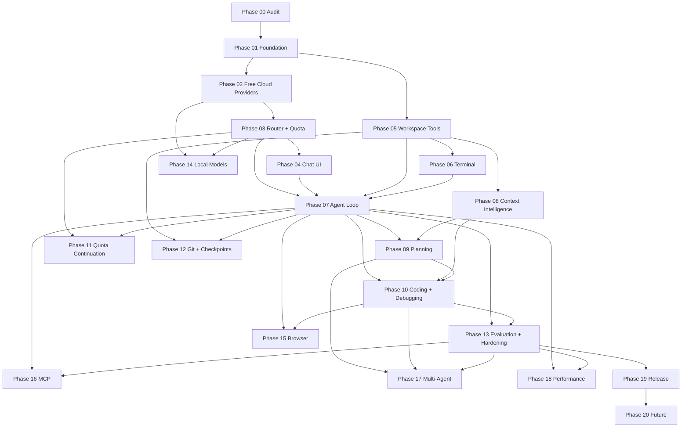

# PHASE DEPENDENCY GRAPH

## 1. Graph



## 2. Dependency Table

| Phase | Hard dependencies | Soft dependencies | Blocks |
|---|---|---|---|
| 00 | none | none | all |
| 01 | 00 | none | 02, 05 |
| 02 | 01 | provider research | 03, 14 |
| 03 | 02 | 01 | 04, 07, 11, 14 |
| 04 | 01, 03 | 02 | 07 |
| 05 | 01 | 08 | 06, 07, 08, 12 |
| 06 | 05 | 07 | 07, 10 |
| 07 | 03, 04, 05, 06 | 08 | 09, 10, 11, 12, 13, 15, 16, 18 |
| 08 | 05 | 07 | 09, 10 |
| 09 | 07, 08 | 10 | 10, 17 |
| 10 | 07, 08, 09 | 06 | 13, 15, 17 |
| 11 | 03, 07 | 10 | MVP hardening |
| 12 | 05, 07 | 10 | release |
| 13 | 07, 10 | 12 | 16, 17, 18, 19 |
| 14 | 02, 03 | 13 | optional |
| 15 | 07, 10 | 13 | optional |
| 16 | 07, 13 | 15 | optional |
| 17 | 09, 10, 13 | 18 | experimental |
| 18 | 07–13 | 19 | 19 |
| 19 | 13 | 12, 18 | 20 |
| 20 | 19 | — | future |

## 3. Critical Path

```text
00 → 01 → 02 → 03 → 04 → 07 → 10 (minimal) → 11 (basic) → 13 → 19
                  ↗
        05 → 06
```

Phase 05 and 06 can proceed in parallel with 02–04 once Phase 01 is complete, because tools are provider-independent.

## 4. Parallel Workstreams

After Phase 01:

- **Inference stream:** 02 → 03
- **Workspace stream:** 05 → 06
- **UI stream:** 04 (requires 03)

After Phase 07:

- **Intelligence stream:** 08 → 09
- **Quality stream:** 13
- **Git stream:** 12
- **Continuation stream:** 11

## 5. MVP Cut Line

Included in MVP:

- 00, 01, 02, 03, 04, 05, 06, 07
- Minimal 10 (validation command + diagnostics)
- Basic 11 (quota pause/resume, no side-effect replay)
- Security controls from 01–07
- Release gate tasks from 19 necessary to run locally (not Marketplace publication)

Deferred:

- Full 08, 09, 12, 14, 15, 16, 17, 18
- Marketplace release tasks in 19
- Phase 20

## 6. Rationale for Reordering

| Original | Revised | Reason |
|---|---|---|
| Quota continuation in Phase 11 | Core quota in Phase 03; continuation in 11 | Router cannot be correct without exhaustion semantics |
| Verification in Phase 10 | Minimal slice in 06/07; full in 10 | Agent loop must be able to check its own work |
| Git in Phase 12 | Read-only Git in Phase 05; checkpoints in 12 | Diff context is useful for review before write integration |
| Local models in Phase 14 | Unchanged | Must remain optional and late |
| Multi-agent in Phase 17 | Unchanged | No evidence yet that it improves outcomes |

## 7. Dependency Rules

1. A phase may start only when its hard dependencies have met their Definition of Done.
2. A phase may not mark a task complete based on code written in a later phase.
3. Shared interfaces (`ProviderAdapter`, `Tool`, `AgentEvent`, `AgentSession`) must be defined before dependent phases; changes require updating all consumers and tests.
4. Security controls are implemented with the feature they protect, not deferred to a later hardening phase.
5. Any phase that changes a public interface must update the relevant architecture document.
